<div align="center">


# TruongFlix

A local media center for macOS and Windows that turns the movies and shows on your drives into a Netflix-style library, with a built-in player, Live TV, a torrent client and, on Windows, a games library.

[Download for macOS](https://github.com/iant4093/TruongFlix/releases/latest/download/TruongFlix-macOS.dmg) · [Download for Windows](https://github.com/iant4093/TruongFlix/releases/latest/download/TruongFlix-Windows-Setup.exe) · [Releases](https://github.com/iant4093/TruongFlix/releases) · [Build status](https://github.com/iant4093/TruongFlix/actions) · [Report an issue](https://github.com/iant4093/TruongFlix/issues)

[](https://github.com/iant4093/TruongFlix/releases/latest/download/TruongFlix-macOS.dmg)
[](https://github.com/iant4093/TruongFlix/releases/latest/download/TruongFlix-Windows-Setup.exe)


[](https://github.com/iant4093/TruongFlix/actions/workflows/ci.yml)

</div>

---

TruongFlix scans the folders you choose, works out what each file is from its name (even scene-release names like `The.Matrix.1999.2160p.UHD.BluRay.x265.HDR.DV-GROUP.mkv`), and fetches artwork, title logos, cast and episode details from TMDB. Everything is cached locally in SQLite, and playback happens inside the app through an embedded mpv engine, with progress synced to Continue Watching. Library metadata stays on your device. Network features include metadata and ratings lookups (TMDB, IMDb datasets, optional OMDb), trailers, optional subtitles, Live TV sports schedules, and torrents you add yourself.

## Screenshots

Screenshots use the development preview with sample metadata and artwork from [TMDB](https://www.themoviedb.org); the games are made-up demo titles. The player capture is the real macOS app playing [Big Buck Bunny](https://peach.blender.org) (© Blender Foundation, CC BY 3.0).

<table>
  <tr>
    <td width="50%" valign="top">
      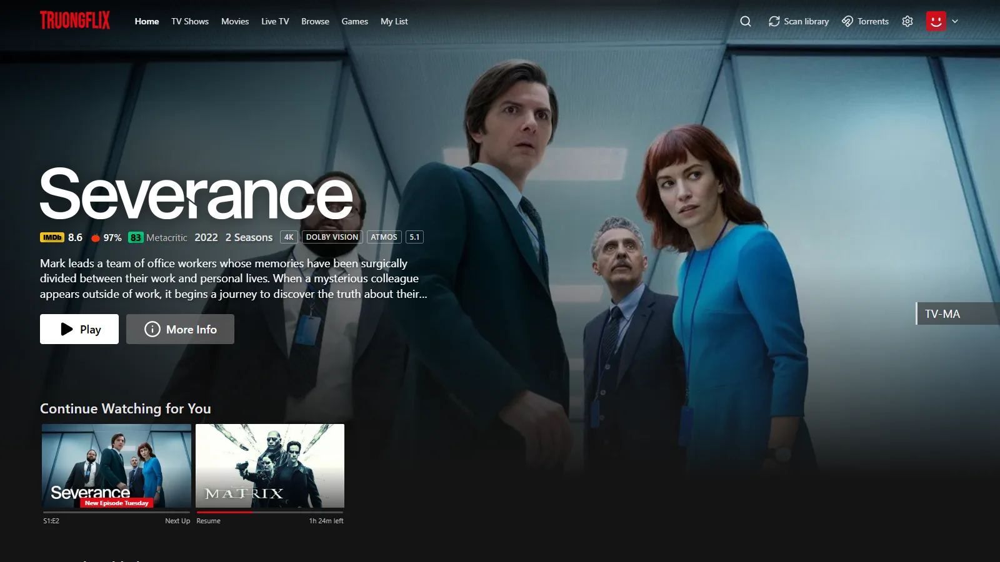
      <p align="center"><sub><b>Home</b> · billboard, ratings and Continue Watching</sub></p>
    </td>
    <td width="50%" valign="top">
      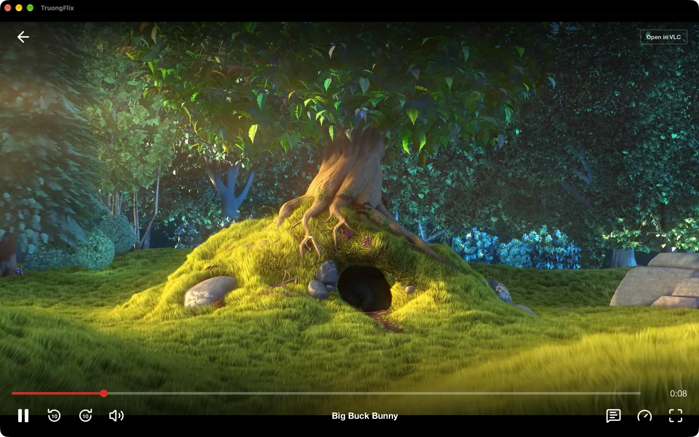
      <p align="center"><sub><b>Built-in player</b> · native video under the app's controls</sub></p>
    </td>
  </tr>
  <tr>
    <td width="50%" valign="top">
      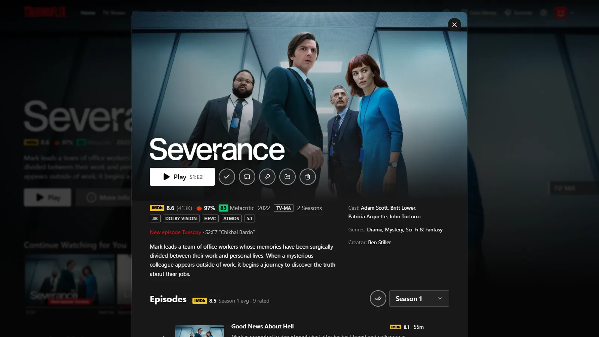
      <p align="center"><sub><b>Show page</b> · details, episodes and file management</sub></p>
    </td>
    <td width="50%" valign="top">
      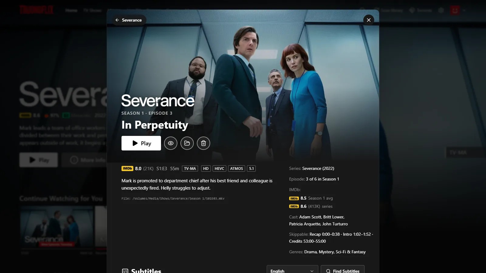
      <p align="center"><sub><b>Episode page</b> · per-episode ratings, skip markers and subtitles</sub></p>
    </td>
  </tr>
  <tr>
    <td width="50%" valign="top">
      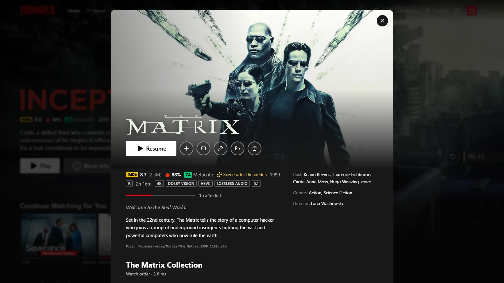
      <p align="center"><sub><b>Movie page</b> · resume, credits scenes and collections</sub></p>
    </td>
    <td width="50%" valign="top">
      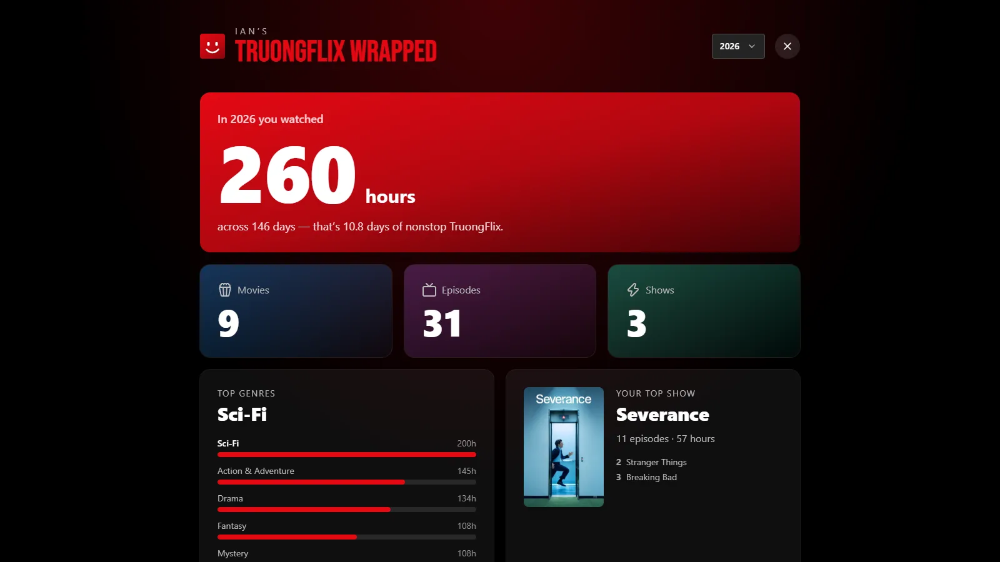
      <p align="center"><sub><b>TruongFlix Wrapped</b> · your year in viewing, per profile</sub></p>
    </td>
  </tr>
  <tr>
    <td width="50%" valign="top">
      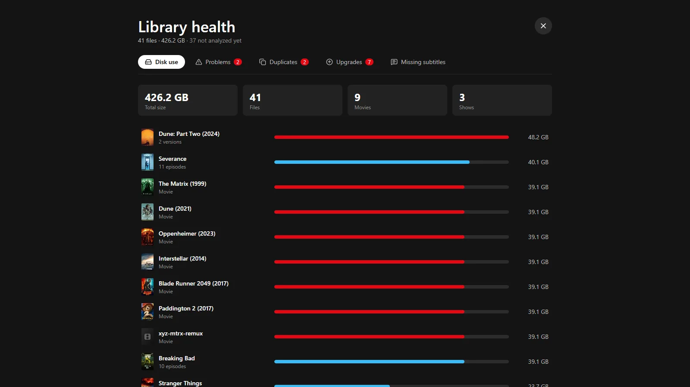
      <p align="center"><sub><b>Library health</b> · disk use, duplicates and upgrades</sub></p>
    </td>
    <td width="50%" valign="top">
      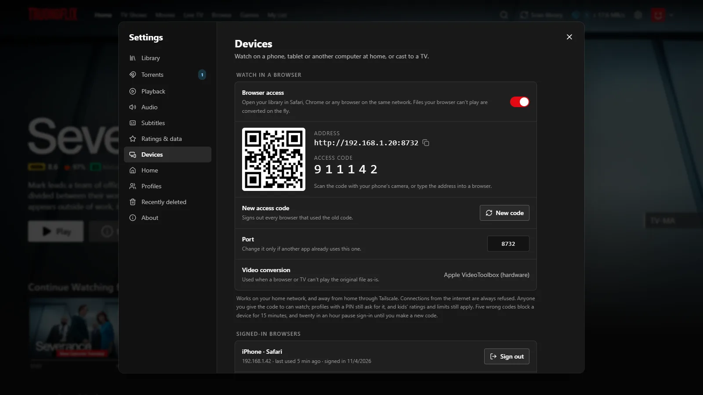
      <p align="center"><sub><b>Watch in a browser</b> · QR code, access code and signed-in browsers</sub></p>
    </td>
  </tr>
  <tr>
    <td width="50%" valign="top">
      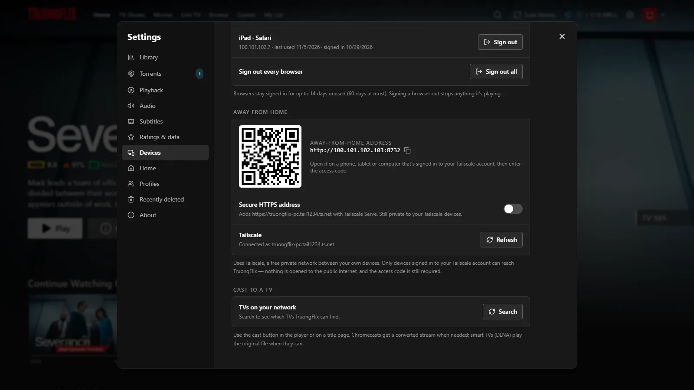
      <p align="center"><sub><b>Away from home</b> · private access through Tailscale</sub></p>
    </td>
    <td width="50%" valign="top">
      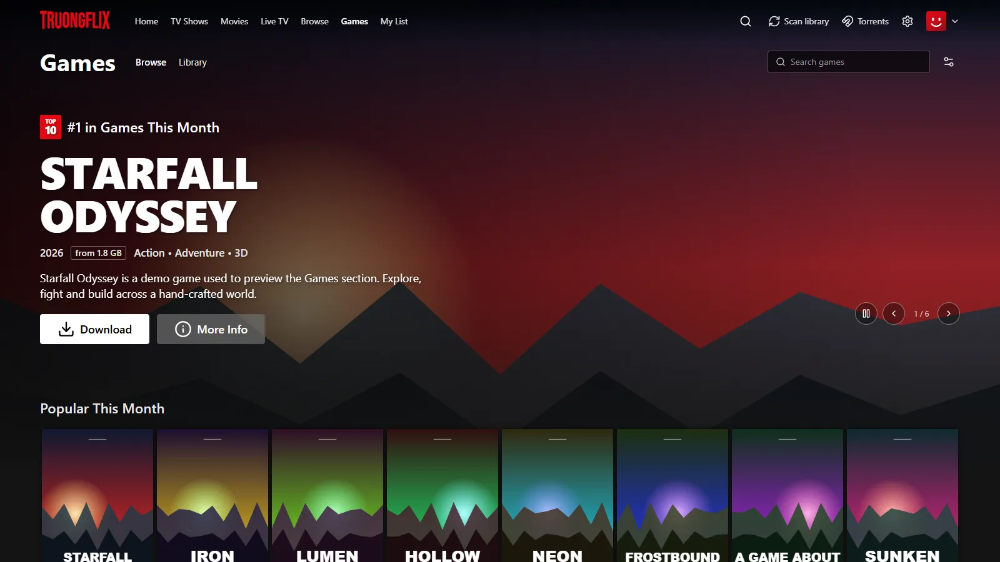
      <p align="center"><sub><b>Games</b> (Windows) · featured games and portrait posters</sub></p>
    </td>
  </tr>
  <tr>
    <td width="50%" valign="top">
      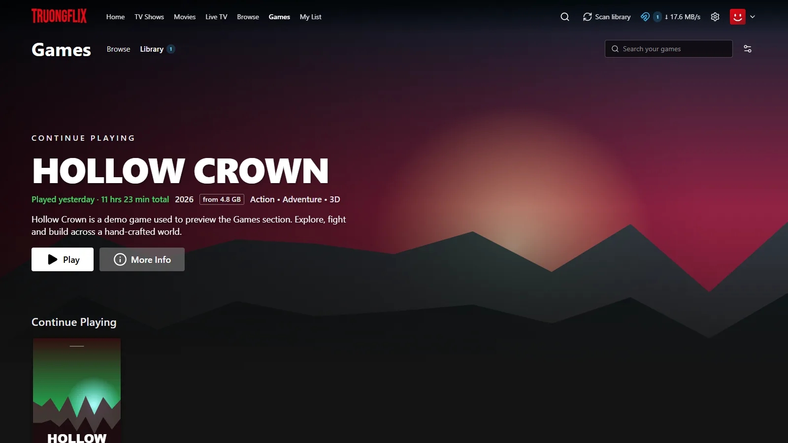
      <p align="center"><sub><b>Games library</b> · play time, downloads and installs</sub></p>
    </td>
    <td width="50%" valign="top">
      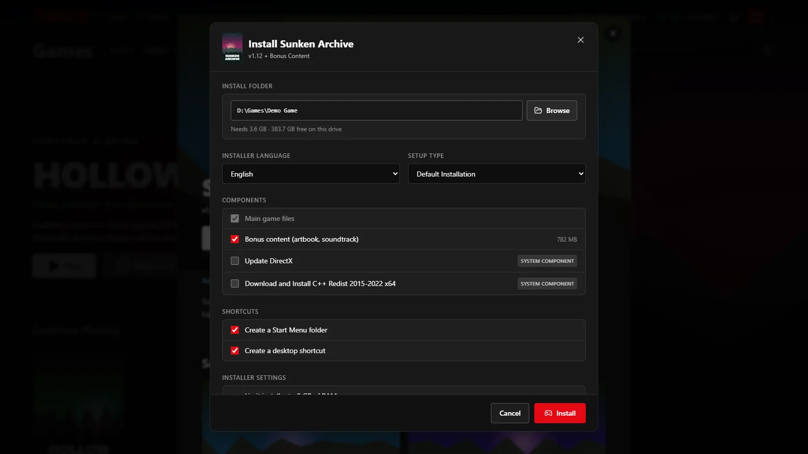
      <p align="center"><sub><b>Install options</b> · every installer choice inside TruongFlix</sub></p>
    </td>
  </tr>
</table>

## Features

**Library**

- Recursive scanning of any number of folders, with incremental re-scans that only process new or changed files
- Folder watching: new downloads, deletions and renames appear on their own within seconds, no Scan button needed
- Scene-filename parsing with parent-folder fallbacks for TV seasons, generic file names and obfuscated releases
- TMDB artwork, transparent title logos, cast, genres and episode details; Fix Match for anything misidentified
- Accurate quality badges read from the actual streams (4K, HDR10, Dolby Vision, HEVC/AV1, Atmos, lossless audio), even for badly named files
- Age ratings (PG-13, TV-MA, …), IMDb ratings for movies, shows, seasons and episodes, Rotten Tomatoes and Metacritic scores (optional free OMDb key), and franchise rows such as "Dune Collection" in watch order
- Missing episodes shown greyed out, plus "New Episode Friday" for shows that are still airing
- Mark a whole season or show as watched or unwatched in one go
- Actor pages: click anyone in the cast to see everything of theirs in your library
- Version picker when you have the same movie in, say, 1080p and 4K
- Back up and restore profiles, watch history, library matches, Browse saves, Live TV playlists and settings, with folder remapping when you restore on another computer. API keys, passwords and the browser access code are left out of backups

**Home**

- Netflix-style billboard with muted HD trailers (up to 1080p), optional sound and replay, without an embedded site's controls or closed captions
- Hover cards that cycle through still frames taken from your actual file
- Continue Watching with TV "Next Up", My List, Top 10, genre rows and search
- A short animated launch intro with its own sound (both can be turned off)

**Browse**

- Discover movies and TV shows beyond your library: trending, popular, new releases, top rated, and title search powered by TMDB, with more titles loaded automatically as you scroll
- Expanded title pages with artwork, ratings, overview, cast, creators and release details; choose a movie, an exact episode with its synopsis, or an entire season
- Quick stream or download for 1080p or 4K releases, ranked by seeders and checked against the torrent's actual files before starting
- Season packs are only picked automatically when every episode is confirmed; otherwise you choose by hand
- Available to unrestricted profiles

**Torrents**

- Built-in BitTorrent client: add a magnet link or `.torrent` file from the navbar, by drag and drop, or by opening it with TruongFlix
- Stream while downloading (temporary, cleared after a time you choose) or download straight into your Movies and TV folders, choosing which files to keep and which title they belong to
- Settings › Torrents: transfer list with filters, pause and resume, move a stream into your library, share-ratio and seeding-time limits, speed limits, port, UPnP/NAT-PMP, peer limits, and DHT, local peer discovery and trackers
- Tuned to stay connected over VPNs, and downloads fetch the rarest pieces first while streams stay in order

**Live TV**

- Add IPTV playlists by URL, pasted M3U text or an `.m3u` file; playlists stay on your computer
- Grouped, searchable channels with favorites and a reachability check
- Sports schedules and scores for the NFL, college football, NBA, WNBA, college basketball, MLB, NHL, MLS, Premier League and Champions League, with favorite teams, matched to your channels
- Multiview: two channels side by side
- Live player with pause and rewind, Go live, previous and next channel, mini-player and fullscreen
- Available to unrestricted profiles

**Games** (Windows)

- Netflix-style Games section: a rotating billboard, portrait posters, search, and game pages with screenshots, sizes and install details
- Downloads use the built-in torrent client with its seeding limits, with optional language and bonus files chosen before downloading
- Installs run inside TruongFlix with the installer's own window hidden and its music muted. Every installer option (language, folder, components, tasks, shortcuts, "limit installer to 2 GB of RAM" and after-install steps) is shown in TruongFlix's install dialog. DirectX, Visual C++ and other system components, and after-install steps, are off by default
- Install automatically when a download finishes (on by default), or review the options first. Installed files are checked against the installer's checksum list when it includes one, and the installer is deleted afterwards unless a file fails the check (can be turned off)
- Library with live download, install and verification progress, Play with play-time tracking, Open folder, Reinstall and silent Uninstall (which also removes saves kept in the game's folder)
- The Windows administrator prompt is only used for installing and uninstalling, and TruongFlix checks every install against the installer itself before asking
- Available to unrestricted profiles. On macOS, Games explains that it needs Windows; the Games code isn't included in Mac builds

**Profiles**

- "Who's watching?" screen with separate Continue Watching, My List and history for each person
- Kids and Teen profiles: Kids shows titles rated up to PG / TV-PG, Teen up to PG-13 / TV-14, and unrated titles are hidden on both
- Daily viewing limits and bedtimes for any profile (the navbar shows the time left today), and optional 4-digit PIN locks. While a kids or teen profile is active, a parent's PIN also protects Settings, profile management, torrents and Live TV playlists
- Viewing Activity history (hide single entries) and **TruongFlix Wrapped**: hours watched, top genres, shows and movies, biggest binge, longest streak, busiest day and a monthly breakdown for each year

**Playback**

- Built-in player powered by libmpv: hardware decoding, HDR tone mapping and nearly every container and codec
- Skip Intro and Skip Recap, from chapter markers or by comparing the audio of a season's episodes to find the shared opening (intros can be skipped automatically), plus buttons to set where an intro starts and ends or where the credits begin, saved for that episode or movie
- Chapter menu with thumbnails (press C) to jump straight to a scene
- "Stay for the credits": movies with a scene during or after the credits say so on their page and when the credits start (from TMDB's tags)
- Mini-player: shrink the video into a corner and keep browsing
- Scrub-bar thumbnails and chapter marks, generated in the background by a second, hidden player
- Next-episode countdown that starts with the credits, the paused "You're watching" screen, and fullscreen
- Keyboard shortcuts: Space or K play/pause, ← → or J L skip 10 s, ↑ ↓ volume, M mute, F fullscreen, I mini-player, C chapters, A audio and subtitles, S skip
- Sleep timer (15, 30, 45, 60 or 90 minutes with a gentle fade-out, or "end of this episode/movie") and Netflix's "Are you still watching?" after several episodes in a row (2–5, or never)
- Media keys, AirPods and headphone buttons, the macOS Now Playing widget and the Windows media overlay, with artwork and a live progress bar
- Subtitle appearance settings (size, color, background box, font), dialogue boost and night mode
- Automatic subtitle sync: lines a subtitle file up with the dialogue in the audio, including subtitles timed for the wrong frame rate, with undo
- Speaker picker with Dolby Atmos, Dolby Digital, DTS and DTS-HD passthrough to an AV receiver, and audio timing remembered per device (handy for Bluetooth lag)
- Pauses automatically when the screen locks, the display sleeps or you close the laptop lid (can be turned off)
- Netflix-style controls: scrubbing, ±10 s, volume, speed, audio and subtitle tracks, and subtitle/audio timing
- Resume points saved as you watch; anything 90% watched is marked complete
- Optional external VLC, as a fallback or as the default player

**Files and subtitles**

- Optional OpenSubtitles integration: search by file hash for perfectly synced results, downloaded next to the video
- Automatic subtitle downloads: missing subtitles in your language are fetched in the background within OpenSubtitles' daily allowance (in-progress titles first), and inexact matches are synced to the dialogue
- Optional Plex-style renaming (`Movie (Year)/Movie (Year).mkv`, `Show/Season 01/Show - S01E01.mkv`) with a full preview and undo
- Loose videos are moved into their own folders along with their subtitles and artwork (on by default, can be turned off)
- Library health page: disk use per title, duplicate copies, unplayable or incomplete downloads, low-quality files worth upgrading, and anything missing subtitles
- Delete movies, shows or single episodes to Recently Deleted, with full restore for 30 days
- Show in Finder / File Explorer, and offline drives are never pruned from the library
- NAS-friendly: network shares reconnect on their own, a sleeping NAS is woken with Wake-on-LAN when you press Play, and shared folders are re-checked every 15 minutes for changes made from other devices

**Other devices**

- Cast to a TV: send playback to a Chromecast or a DLNA smart TV, with play/pause, seeking and progress kept in sync. Files the TV can't play are converted on the fly (H.264/AAC, HDR tone-mapped to SDR)
- Watch in a browser on your home network: turn on browser access in Settings › Devices, scan the QR code with a phone or tablet and enter the 6-digit access code. Profiles, PINs, kids' ratings, limits and progress are shared with the desktop app, with full-length scrubbing, subtitles, audio tracks, chapters, Skip Intro and next-episode advance
- Watch away from home through [Tailscale](https://tailscale.com): Settings › Devices shows your private Tailscale address and can add an HTTPS address with Tailscale Serve, reachable only by devices on your Tailscale account
- Browser access is locked down: connections from the public internet are always refused, five wrong codes lock a device out for 15 minutes, twenty in an hour pause sign-in until you make a new code, and browsers are signed out after 14 days unused (60 days at most). Settings › Devices lists every signed-in browser so you can sign any of them out

## Install

**macOS** (Apple Silicon)

1. Download [TruongFlix-macOS.dmg](https://github.com/iant4093/TruongFlix/releases/latest/download/TruongFlix-macOS.dmg) and drag TruongFlix into Applications.
2. Open TruongFlix. macOS will say it can't verify the developer, because release builds are ad-hoc signed rather than notarized. Click **Done**, then go to **System Settings › Privacy & Security**, scroll down to the message about TruongFlix and click **Open Anyway**, then confirm with your password. You only need to do this once.

**Windows** (x64, Windows 10 or later)

1. Download [TruongFlix-Windows-Setup.exe](https://github.com/iant4093/TruongFlix/releases/latest/download/TruongFlix-Windows-Setup.exe) and run it.
2. If SmartScreen appears, choose **More info › Run anyway**. The installer is not code-signed.

On first launch, the setup wizard asks for a free [TMDB API key](https://www.themoviedb.org/settings/api), your playback preference (built-in player or VLC), an optional [OpenSubtitles key](https://www.opensubtitles.com/en/consumers), and your media folders, or you can restore a TruongFlix backup instead. The player engine is included, so no other software is required. The download buttons always point to the most recent successfully published release.

Installed copies check for a new version once a day (or from **Settings › About**), show what changed, and install it when you choose after verifying its signature.

## Tech stack

| Area | Technologies |
|---|---|
| App shell | Tauri 2 (Rust), WKWebView on macOS, WebView2 on Windows |
| Interface | React 18, TypeScript, Vite, Tailwind CSS, Framer Motion, Zustand, lucide-react |
| Playback | libmpv with FFmpeg; macOS: CAOpenGLLayer under a transparent webview; Windows: owned video window behind a transparent window |
| Streaming | Built-in HTTP server with byte ranges, on-demand VOD HLS and MPEG-TS conversion through a headless libmpv encoder (VideoToolbox / NVENC / Quick Sync / AMF / Media Foundation / x264), Cast v2 and UPnP AVTransport, Bonjour/mDNS and SSDP discovery, native HLS on Apple devices and hls.js elsewhere |
| Torrents | librqbit, with small patches for rarest-first downloads |
| Metadata | TMDB API v3, IMDb non-commercial datasets, OMDb, OpenSubtitles REST API, ESPN scoreboards for Live TV sports |
| Trailers | yt-dlp and Deno helpers, bundled and checksum-verified |
| Storage | SQLite via tauri-plugin-sql, local file operations and a same-volume trash |
| Delivery | GitHub Actions, macOS `.dmg`, Windows NSIS installer, signed auto-updates, SHA-256 checksums |

## Build locally

Requires **Node 22.12+**, **Rust stable** and the [Tauri prerequisites](https://v2.tauri.app/start/prerequisites/) for your platform. On macOS, also install mpv (`brew install mpv`), which the bundler copies into the app. On Windows, `bundle:libmpv` needs [7-Zip](https://www.7-zip.org) to unpack libmpv.

```bash
npm install

# Desktop app with hot reload
npm run app:dev

# UI-only preview in a browser, with a mocked backend and sample data
npm run dev

# Copy the player engine into src-tauri/libmpv/ (macOS: Homebrew's libmpv; Windows: downloads libmpv-2.dll)
npm run bundle:libmpv
npm run bundle:trailers

# Release build: bundles libmpv and the trailer helpers, builds installers, signs updates, writes latest.json
npm run app:build
```

Desktop dev/build commands automatically prepare checksum-verified yt-dlp and Deno sidecars for HD trailers. The helpers and their licenses are included in installers; users do not need to install them. Run `npm run bundle:trailers` before running Rust tests directly.

`app:build` signs updates with `~/.tauri/truongflix.key` or `$TAURI_SIGNING_PRIVATE_KEY`. Generate a key once with `npx tauri signer generate -w ~/.tauri/truongflix.key`. Without it, use `npx tauri build` for an unsigned local build.

## Tests

```bash
# Frontend unit and component tests (Vitest)
npm test

# TypeScript check and production frontend build
npm run build

# Rust unit tests: scanner, subtitles and subtitle sync, file management and renaming, intro fingerprinting, NAS helpers,
# IMDb parsing, VLC, cast protocols (incl. a simulated DLNA TV), torrents, backups, Live TV, browser-access security,
# Tailscale and game installs
cd src-tauri && cargo test

# Network and engine tests (real IMDb datasets, OpenSubtitles, VLC, a simulated Chromecast, Bonjour discovery,
# and stream conversion with TRUONGFLIX_STREAM_TEST=/path/to/video.mkv)
cd src-tauri && cargo test -- --ignored

# Built-in player smoke test on macOS: renders into a real window and reports drawn frames
cd src-tauri && TRUONGFLIX_PLAYER_PROBE=1 cargo run --example player_smoke -- /path/to/video.mkv
```

For debugging playback in the app, run `TRUONGFLIX_PLAYER_DEBUG=1 npm run app:dev`, which logs frame and state information.

## CI and releases

Pull requests and pushes to `main` run:

1. Vitest unit tests, a TypeScript check and a production frontend build.
2. macOS and Windows builds: libmpv and trailer-helper bundling, Rust tests and installer packaging.
3. A Windows smoke test of the embedded web view, which fails the build if it breaks.
4. A Windows player smoke test that launches the built app on a sample video and captures screenshots as an artifact.

After all builds pass, pushes to `main` (and manual runs on `main`) publish a GitHub Release `v<major>.<minor>.<run number>` containing `TruongFlix-macOS.dmg`, `TruongFlix-Windows-Setup.exe`, the macOS updater archive, `latest.json` (with the update signatures) and `SHA256SUMS`. The release notes are generated from the commit messages since the previous release, and the same list appears in the app's update prompt. Installed apps pick up the new version through `latest.json`. Pull requests never publish.

The updater signing key is stored as the `TAURI_SIGNING_PRIVATE_KEY` repository secret. Builds without it (such as fork pull requests) still produce installers, just without update signatures. GitHub Actions are pinned to commit SHAs, and Dependabot checks them weekly.

## Repository layout

```text
.
├── src/                    React app
│   ├── components/         Library, browse, Live TV, player, cast, torrents, profiles, modals, settings, layout and shared UI
│   ├── services/           Scanner, parser, TMDB, IMDb, OMDb, subtitles, files, renaming, media analysis, player, torrents,
│   │                       Live TV, casting, streaming, NAS, limits, Wrapped, browser access, updates, SQLite
│   ├── store/              Zustand store and library selectors
│   ├── games/              Games (Windows only): catalog parsing, installer options, library and install jobs, screens
│   ├── remote/             Browser app served to phones, tablets and other computers
│   ├── hooks/ lib/ types/  Shared hooks, formatting and platform helpers, and types
│   └── dev/                Browser-preview mock of the Tauri backend (dev only)
├── src-tauri/              Rust backend
│   ├── src/player/         libmpv bindings, macOS/Windows video surfaces and Live TV multiview
│   ├── src/games/          Windows game installs: installer reading, install checks, hidden-wizard helper, verification, launching
│   ├── src/                Scanner, folder watcher, media analysis (probe, frames, intro detection), torrents, Live TV, VLC,
│   │                       subtitles and sync, files, backups, IMDb, NAS, Now Playing, media server and stream conversion,
│   │                       browser-access security, Tailscale, Chromecast/DLNA casting
│   ├── vendor/             Patched librqbit (rarest-first downloads) and inno (installer conditions); see PATCHES.md
│   ├── capabilities/       Tauri permissions
│   └── examples/           Smoke tests
├── tests/                  Vitest tests
├── scripts/                libmpv and trailer-helper bundling, release packaging
├── docs/                   README screenshots and icon
├── .github/                CI/release workflow and Dependabot
└── README.md
```

TruongFlix uses the TMDB API but is not endorsed or certified by TMDB. IMDb data is used under IMDb's non-commercial terms.
