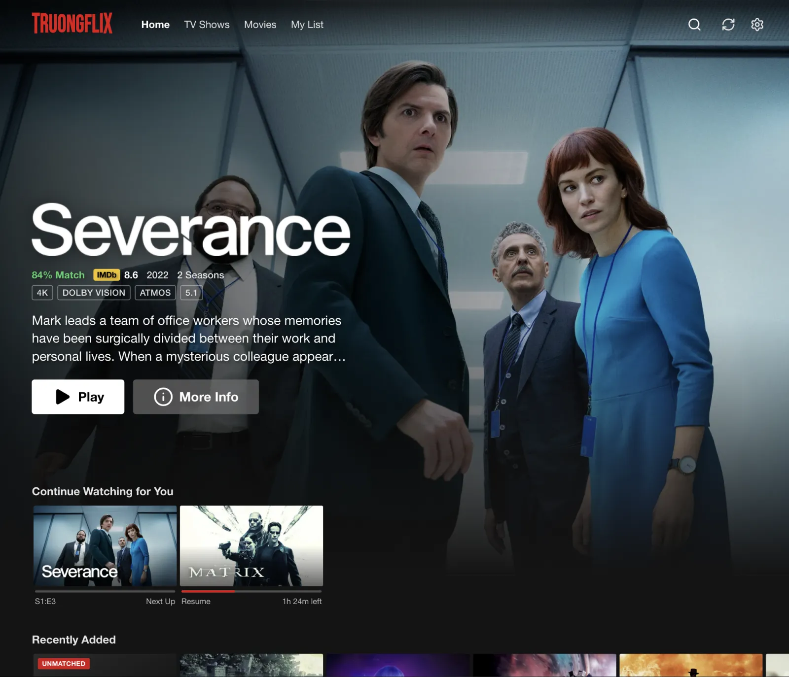
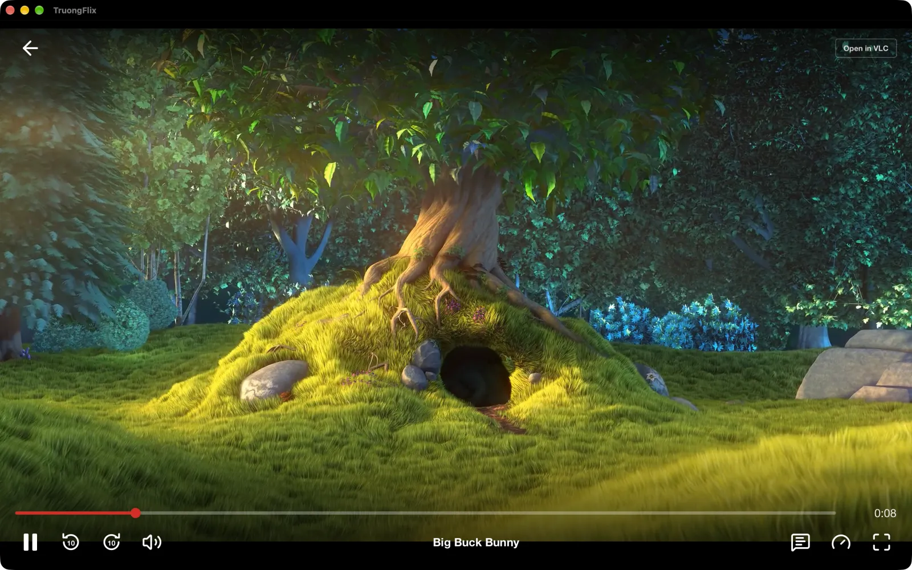
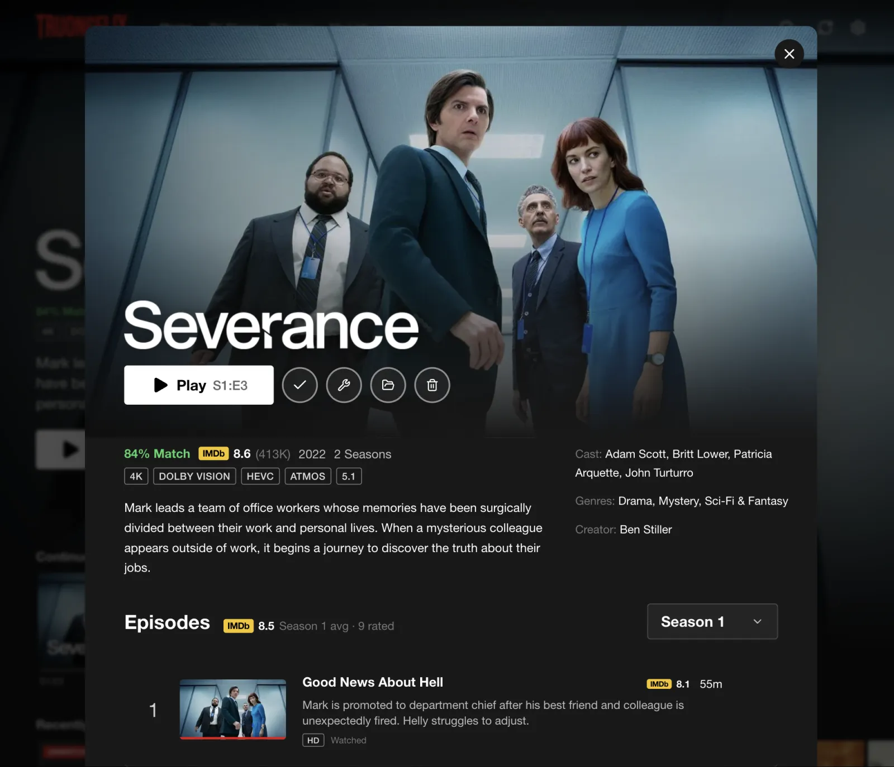
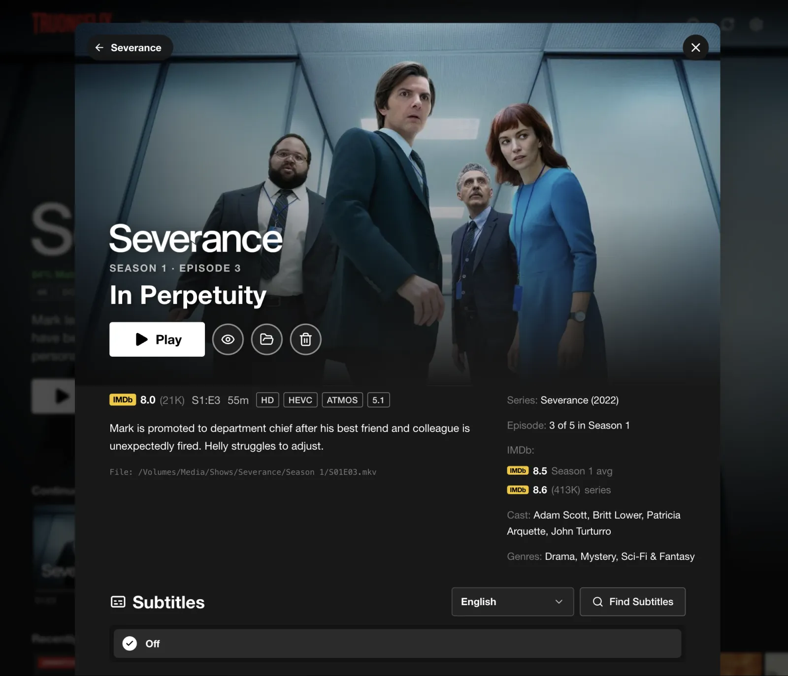

<div align="center">


# TruongFlix

A local media center for macOS and Windows that turns the movies and shows on your drives into a Netflix-style library, with a built-in player.

[Download for macOS](https://github.com/iant4093/TruongFlix/releases/latest/download/TruongFlix-macOS.dmg) · [Download for Windows](https://github.com/iant4093/TruongFlix/releases/latest/download/TruongFlix-Windows-Setup.exe) · [Releases](https://github.com/iant4093/TruongFlix/releases) · [Build status](https://github.com/iant4093/TruongFlix/actions) · [Report an issue](https://github.com/iant4093/TruongFlix/issues)

[](https://github.com/iant4093/TruongFlix/releases/latest/download/TruongFlix-macOS.dmg)
[](https://github.com/iant4093/TruongFlix/releases/latest/download/TruongFlix-Windows-Setup.exe)


[](https://github.com/iant4093/TruongFlix/actions/workflows/ci.yml)

</div>

---

TruongFlix scans the folders you choose, works out what each file is from its name (even scene-release names like `The.Matrix.1999.2160p.UHD.BluRay.x265.HDR.DV-GROUP.mkv`), and fetches artwork, title logos, cast and episode details from TMDB. Everything is cached locally in SQLite, and playback happens inside the app through an embedded mpv engine, with progress synced to Continue Watching. Nothing is uploaded; the only network requests are metadata and ratings lookups (TMDB, IMDb datasets, optional OMDb), trailers on the home banner, plus optional subtitle downloads.

## Screenshots

Library screenshots use the development preview with sample metadata and artwork from [TMDB](https://www.themoviedb.org). The player capture is the real macOS app playing [Big Buck Bunny](https://peach.blender.org) (© Blender Foundation, CC BY 3.0).

<table>
  <tr>
    <td width="50%" valign="top">
      
      <p align="center"><sub><b>Home</b> · billboard, ratings and Continue Watching</sub></p>
    </td>
    <td width="50%" valign="top">
      
      <p align="center"><sub><b>Built-in player</b> · native video under the app's controls</sub></p>
    </td>
  </tr>
  <tr>
    <td width="50%" valign="top">
      
      <p align="center"><sub><b>Title page</b> · details, actions and file management</sub></p>
    </td>
    <td width="50%" valign="top">
      
      <p align="center"><sub><b>Episode page</b> · per-episode ratings and subtitles</sub></p>
    </td>
  </tr>
</table>

## Features

**Library**

- Recursive scanning of any number of folders, with incremental re-scans that only process new or changed files
- Folder watching: new downloads, deletions and renames appear on their own within seconds, no Scan button needed
- Scene-filename parsing with parent-folder fallbacks for TV seasons, generic file names and obfuscated releases
- TMDB artwork, transparent title logos, cast, genres and episode details; Fix Match for anything misidentified
- Accurate quality badges read from the actual streams (4K, HDR10, Dolby Vision, HEVC/AV1, Atmos, lossless audio), even for badly named files
- Age ratings (PG-13, TV-MA, …), IMDb ratings for movies, shows, seasons and episodes, Rotten Tomatoes and Metacritic scores (optional free OMDb key), and franchise rows such as "Dune Collection" in watch order
- Missing episodes shown greyed out, plus "New Episode Friday" for shows that are still airing
- Mark a whole season or show as watched or unwatched in one go
- Actor pages: click anyone in the cast to see everything of theirs in your library
- Version picker when you have the same movie in, say, 1080p and 4K

**Home**

- Netflix-style billboard that fades into the title's muted trailer after a few seconds
- Hover cards that cycle through still frames taken from your actual file
- Continue Watching with TV "Next Up", My List, Top 10, genre rows and search
- A short animated launch intro with its own sound (both can be turned off)

**Profiles**

- "Who's watching?" screen with separate Continue Watching, My List and history for each person
- Kids and Teen profiles that only show titles up to the matching age rating
- Daily viewing limits and bedtimes per profile, and optional 4-digit PIN locks (a parent's PIN also protects Settings while a kids profile is active)
- Viewing Activity history and **TruongFlix Wrapped**: hours watched, top genres and shows, biggest binge and longest streak for each year

**Playback**

- Built-in player powered by libmpv: hardware decoding, HDR tone mapping and nearly every container and codec
- Skip Intro and Skip Recap, from chapter markers or by comparing the audio of a season's episodes to find the shared opening (optionally automatic), plus "Starts here / Ends here" buttons to fix an intro or credits marker by hand for a single episode
- Chapter menu with thumbnails (press C) to jump straight to a scene
- "Stay for the credits": movies with a scene during or after the credits say so on their page and when the credits start (from TMDB's tags)
- Mini-player: shrink the video into a corner and keep browsing
- Scrub-bar thumbnails and chapter marks, generated in the background by a second, hidden player
- Next-episode countdown that starts with the credits, the paused "You're watching" screen, fullscreen and keyboard shortcuts
- Sleep timer (15–90 minutes with a gentle fade-out, or "end of this episode") and Netflix's "Are you still watching?" after several episodes in a row
- Media keys, AirPods and headphone buttons, the macOS Now Playing widget and the Windows media overlay, with artwork and a live progress bar
- Subtitle appearance settings (size, colour, background box, font), dialogue boost and night mode
- Automatic subtitle sync: lines a subtitle file up with the dialogue in the audio, including subtitles timed for the wrong frame rate, with undo
- Speaker picker with Dolby Atmos/DTS passthrough to an AV receiver, and audio timing remembered per device (handy for Bluetooth lag)
- Pauses automatically when the screen locks, the display sleeps or you close the laptop lid
- Netflix-style controls: scrubbing, ±10 s, volume, speed, audio and subtitle tracks, and subtitle/audio timing
- Resume points saved as you watch; anything 90% watched is marked complete
- Optional external VLC, as a fallback or as the default player

**Files and subtitles**

- Optional OpenSubtitles integration: search by file hash for perfectly synced results, downloaded next to the video
- Automatic subtitle downloads: missing subtitles in your language are fetched in the background within OpenSubtitles' daily allowance (in-progress titles first), and inexact matches are synced to the dialogue
- Optional Plex-style renaming (`Movie (Year)/Movie (Year).mkv`, `Show/Season 01/Show - S01E01.mkv`) with a full preview and undo
- Loose videos are organized into their own folders, along with their subtitles and artwork
- Library health page: disk use per title, duplicate copies, unplayable or incomplete downloads, low-quality files worth upgrading, and anything missing subtitles
- Delete movies, shows or single episodes to Recently Deleted, with full restore for 30 days
- Show in Finder / File Explorer, and offline drives are never pruned from the library
- NAS-friendly: network shares reconnect on their own, a sleeping NAS is woken with Wake-on-LAN when you press Play, and shared folders are re-checked for changes made from other devices

**Other screens**

- Cast to a TV: send playback to a Chromecast or a DLNA smart TV, with play/pause, seeking and progress kept in sync. Files the TV can't play are converted on the fly (H.264/AAC, HDR tone-mapped to SDR)
- Watch in a browser on your home network: turn on browser access in Settings › Devices, scan the QR code with a phone or tablet and enter the access code. Profiles, PINs, kids' limits and progress are shared with the desktop app, with full-length VOD scrubbing, subtitles, audio tracks, chapters, Skip Intro and next-episode advance

## Install

**macOS** (Apple Silicon)

1. Download [TruongFlix-macOS.dmg](https://github.com/iant4093/TruongFlix/releases/latest/download/TruongFlix-macOS.dmg) and drag TruongFlix into Applications.
2. Open TruongFlix. macOS will say it can't verify the developer, because release builds are ad-hoc signed rather than notarized. Click **Done**, then go to **System Settings › Privacy & Security**, scroll down to the message about TruongFlix and click **Open Anyway**, then confirm with your password. You only need to do this once.

**Windows** (x64, Windows 10 or later)

1. Download [TruongFlix-Windows-Setup.exe](https://github.com/iant4093/TruongFlix/releases/latest/download/TruongFlix-Windows-Setup.exe) and run it.
2. If SmartScreen appears, choose **More info › Run anyway**. The installer is not code-signed.

On first launch, the setup wizard asks for a free [TMDB API key](https://www.themoviedb.org/settings/api), an optional [OpenSubtitles key](https://www.opensubtitles.com/en/consumers), and your media folders. The player engine is included, so no other software is required. The download buttons always point to the most recent successfully published release.

Installed copies update themselves: they check for a new version once a day (or from **Settings › About**) and install it after verifying its signature.

## Tech stack

| Area | Technologies |
|---|---|
| App shell | Tauri 2 (Rust), WKWebView on macOS, WebView2 on Windows |
| Interface | React 18, TypeScript, Vite, Tailwind CSS, Framer Motion, Zustand |
| Playback | libmpv with FFmpeg; macOS: CAOpenGLLayer under a transparent webview; Windows: owned video window behind a transparent window |
| Streaming | Built-in HTTP server with byte ranges, on-demand VOD HLS and MPEG-TS conversion through a headless libmpv encoder (VideoToolbox / NVENC / Quick Sync / AMF / Media Foundation / x264), Cast v2 and UPnP AVTransport, Bonjour/mDNS and SSDP discovery, native HLS on Apple devices and hls.js elsewhere |
| Metadata | TMDB API v3, IMDb non-commercial datasets, OpenSubtitles REST API |
| Storage | SQLite via tauri-plugin-sql, local file operations and a same-volume trash |
| Delivery | GitHub Actions, macOS `.dmg`, Windows NSIS installer, signed auto-updates, SHA-256 checksums |

## Build locally

Requires **Node 22+**, **Rust stable** and the [Tauri prerequisites](https://v2.tauri.app/start/prerequisites/) for your platform. On macOS, also install mpv (`brew install mpv`), which the bundler copies into the app.

```bash
npm install

# Desktop app with hot reload
npm run app:dev

# UI-only preview in a browser, with a mocked backend and sample data
npm run dev

# Copy the player engine into src-tauri/libmpv/ (macOS: Homebrew's libmpv; Windows: downloads libmpv-2.dll)
npm run bundle:libmpv

# Release build: bundles libmpv, builds installers, signs the updater archive, writes latest.json
npm run app:build
```

`app:build` signs updates with `~/.tauri/truongflix.key` or `$TAURI_SIGNING_PRIVATE_KEY`. Generate a key once with `npx tauri signer generate -w ~/.tauri/truongflix.key`. Without it, use `npx tauri build` for an unsigned local build.

## Tests

```bash
# TypeScript check and production frontend build
npm run build

# Rust unit tests: scanner, subtitles and subtitle sync, file management and renaming, intro fingerprinting, NAS helpers, IMDb parsing, VLC auth, cast protocols (incl. a simulated DLNA TV)
cd src-tauri && cargo test

# Network and engine tests (real IMDb datasets, OpenSubtitles, VLC, a simulated Chromecast, Bonjour discovery,
# and stream conversion with TRUONGFLIX_STREAM_TEST=/path/to/video.mkv)
cd src-tauri && cargo test -- --ignored

# Built-in player smoke test on macOS: renders into a real window and reports drawn frames
cd src-tauri && TRUONGFLIX_PLAYER_PROBE=1 cargo run --example player_smoke -- /path/to/video.mkv
```

For debugging playback in the app, run `TRUONGFLIX_PLAYER_DEBUG=1 npm run app:dev`, which logs frame and state information.

## CI and releases

Pull requests and pushes to `main` run:

1. A TypeScript check and production frontend build.
2. macOS and Windows builds: libmpv bundling, Rust tests and installer packaging.
3. A Windows player smoke test that launches the built app on a sample video and captures screenshots as an artifact.

After all builds pass, pushes to `main` publish a GitHub Release `v<major>.<minor>.<run number>` containing `TruongFlix-macOS.dmg`, `TruongFlix-Windows-Setup.exe`, the signed updater archives, `latest.json` and `SHA256SUMS`. The release notes are generated from the commit messages since the previous release, and the same list appears in the app's update prompt. Installed apps pick up the new version through `latest.json`. Pull requests never publish.

The updater signing key is stored as the `TAURI_SIGNING_PRIVATE_KEY` repository secret. Builds without it (such as fork pull requests) still produce installers, just without update signatures. GitHub Actions are pinned to commit SHAs, and Dependabot checks them weekly.

## Repository layout

```text
.
├── src/                    React app
│   ├── components/         Library, player, profiles, modals, settings and shared UI
│   ├── services/           Scanner, parser, TMDB, IMDb, subtitles, files, renaming, media analysis, player, updates, SQLite
│   ├── store/              Zustand store and library selectors
│   ├── remote/             Browser app served to phones, tablets and other computers on the home network
│   └── dev/                Browser-preview mock of the Tauri backend (dev only)
├── src-tauri/              Rust backend
│   ├── src/player/         libmpv bindings and macOS/Windows video surfaces
│   ├── src/                Scanner, folder watcher, media analysis (probe, frames, intro detection), VLC, subtitles, files, IMDb,
│   │                       media server and stream conversion (stream.rs), Chromecast/DLNA casting (cast.rs)
│   └── examples/           Player smoke test
├── scripts/                libmpv bundling and release packaging
├── docs/                   README screenshots and icon
├── .github/                CI/release workflow and Dependabot
└── README.md
```

TruongFlix uses the TMDB API but is not endorsed or certified by TMDB. IMDb data is used under IMDb's non-commercial terms.
